# 演示彩排 · 操作图册-测试环境自动跑

> 环境：`http://127.0.0.1:8092` → `campus_trade_test`-**未触碰演示库**。共 17 步。
> 用途：上台前照着这组图熟悉操作顺序。

| # | 步骤 | 说明 | 截图 |
| :-: | --- | --- | --- |
| 01 | 首页-8段分类色带+卡片编号 | 讲：分类按在售量着色，卡片带分类编号 | `01-首页-8段分类色带+卡片编号.png` |
| 02 | 搜「教材」 | 共 2 件-含分类命中的商品 | `02-搜「教材」.png` |
| 03 | 商品详情-相关推荐+评价区 | 讲：详情、相关推荐、卖家卡片 | `03-商品详情-相关推荐+评价区.png` |
| 04 | 卖家主页-信用分/已售出/收到的评价 | 加分点：点卖家头像看历史与口碑 | `收到的评价.png` |
| 05 | 买家下单成功 | 商品变「交易中」；下单即锁定，防一物多卖 | `05-买家下单成功.png` |
| 06 | 卖家顶栏订单徽标 | 顶栏「订单」出现红色待办数字 | `06-卖家顶栏订单徽标.png` |
| 07 | 卖家「我卖出的」列表 | 待交易行有「标记可交付」按钮 | `07-卖家「我卖出的」列表.png` |
| 08 | 卖家：标记可交付 | 状态 0 → 1 待交付 | `08-卖家：标记可交付.png` |
| 09 | 卖家：确认已交付 | 状态 1 → 2 待收货；卖家不能替买家确认 | `09-卖家：确认已交付.png` |
| 10 | 买家「我买到的」 | 待收货行出现「确认收货」 | `10-买家「我买到的」.png` |
| 11 | 买家确认收货 → 已完成 | 商品已售出；双方信用分 +1 | `11-买家确认收货 → 已完成.png` |
| 12 | 评价弹窗-星级/标签/匿名 | 勾选匿名；每单每人一次 | `匿名.png` |
| 13 | 评价提交后 | 成功提示或弹窗关闭 | `13-评价提交后.png` |
| 14 | 后台商品审核 | 有 1 件待审核：通过/驳回 + 审核意见 | `14-后台商品审核.png` |
| 15 | 后台用户管理 | 启用/禁用 + 审计日志 | `15-后台用户管理.png` |
| 16 | 后台数据看板 | 用户/商品/订单/举报趋势 | `16-后台数据看板.png` |
| 17 | 买家消息列表 | WebSocket 实时 + 已读回执 | `17-买家消息列表.png` |

## 逐步截图

### 01-首页-8段分类色带+卡片编号

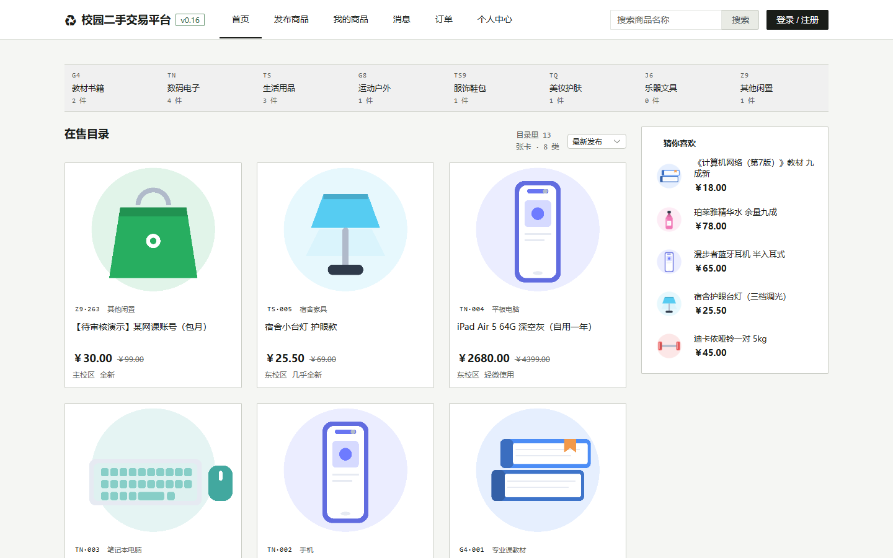

### 02-搜「教材」

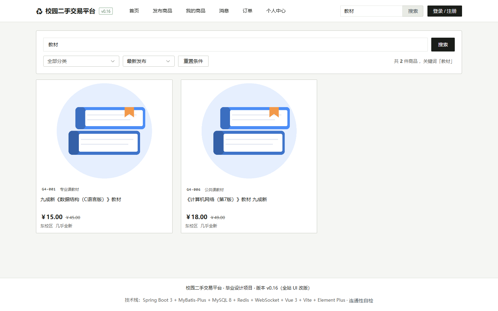

### 03-商品详情-相关推荐+评价区

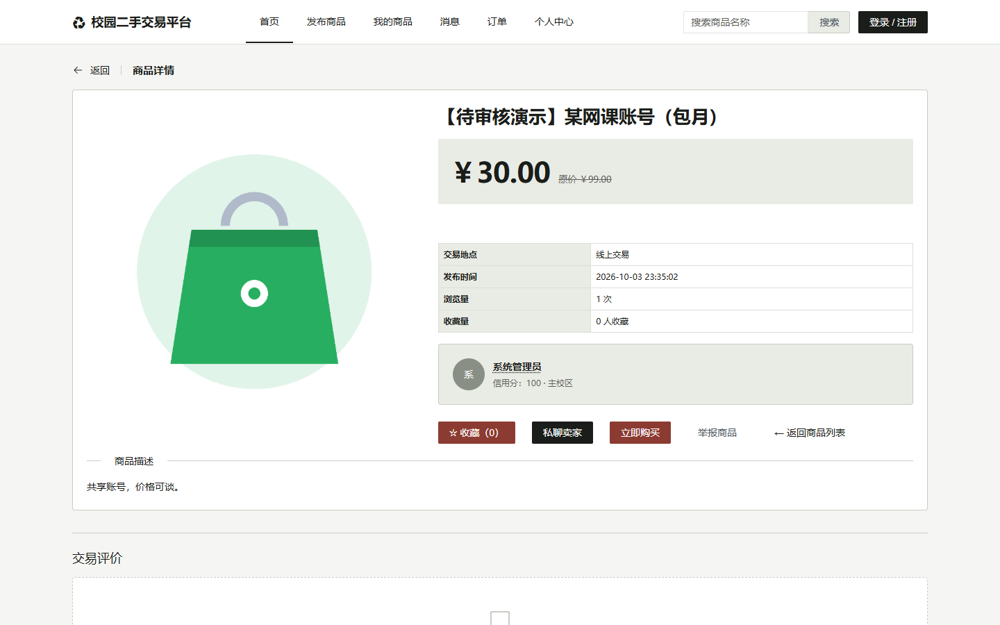

### 05-买家下单成功

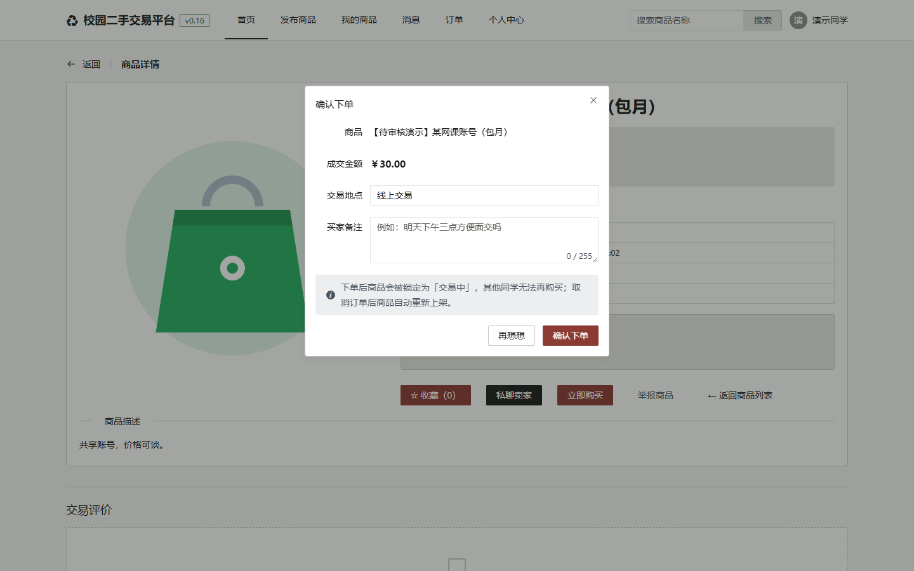

### 06-卖家顶栏订单徽标

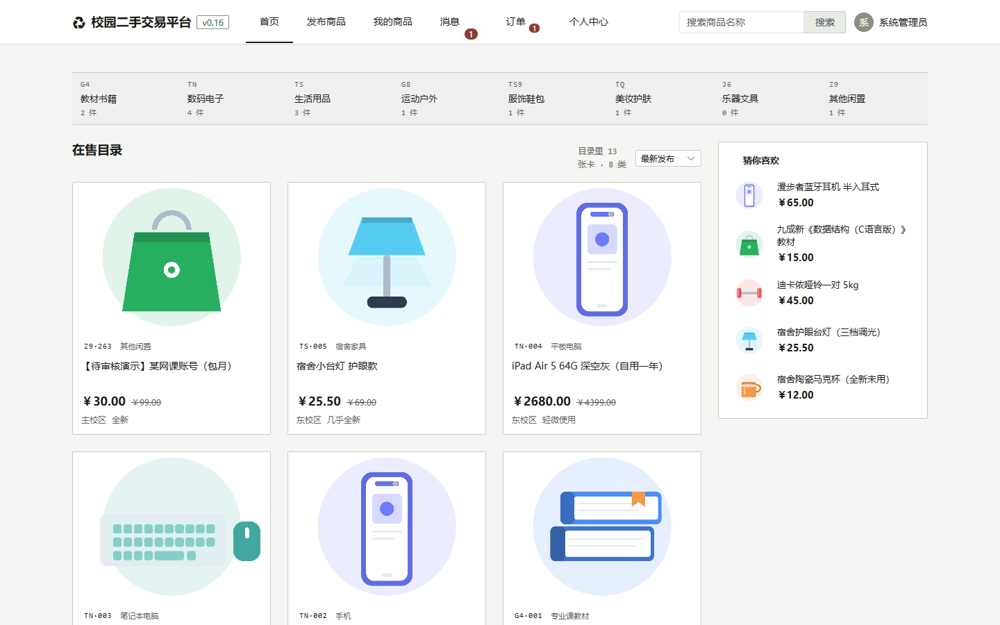

### 07-卖家「我卖出的」列表

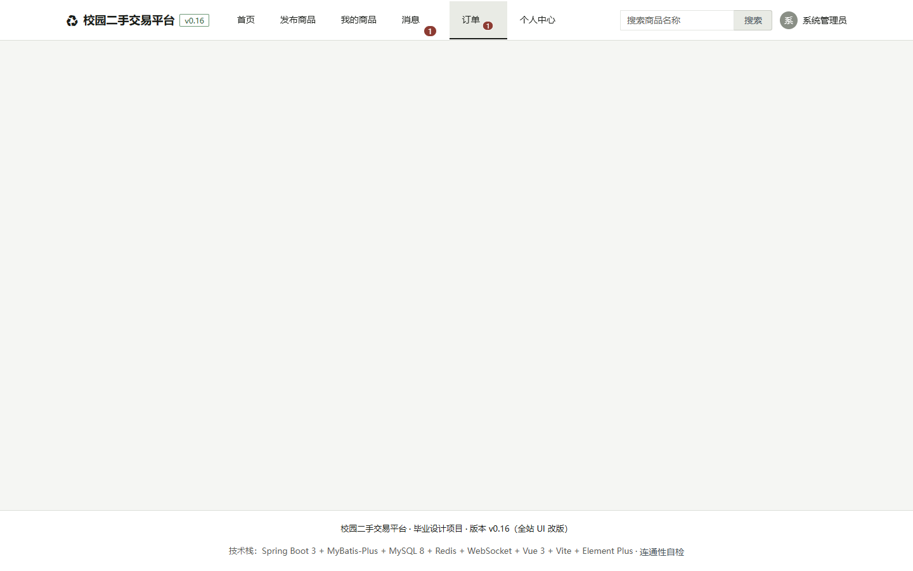

### 08-卖家：标记可交付

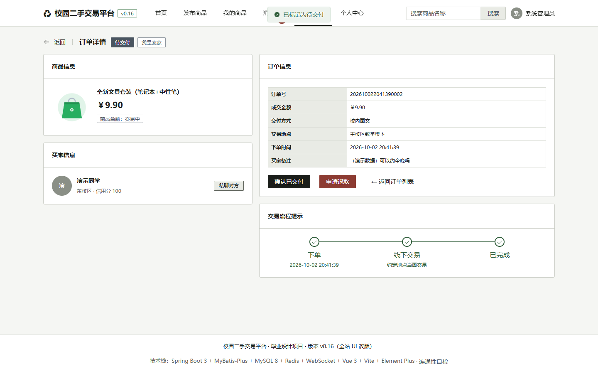

### 09-卖家：确认已交付

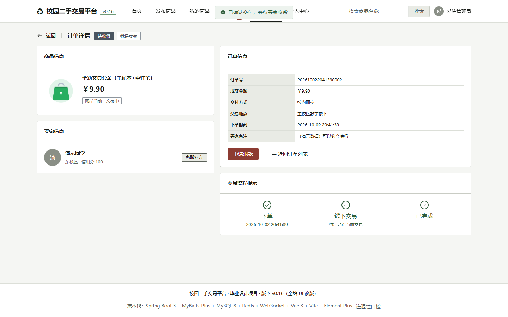

### 10-买家「我买到的」

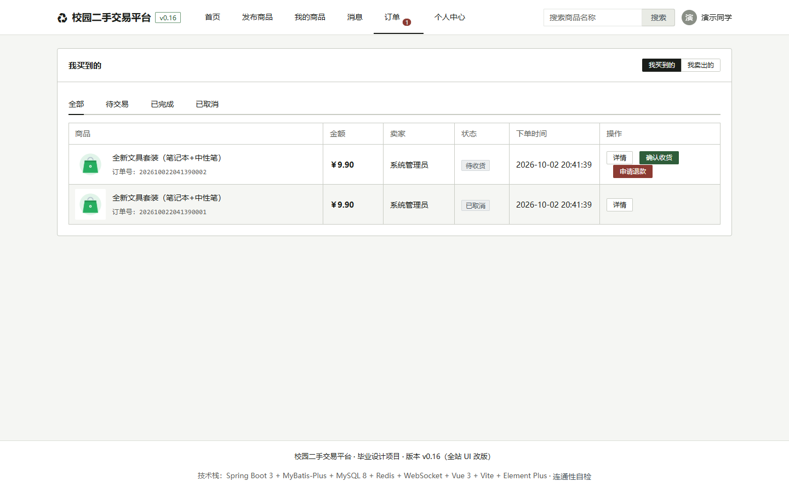

### 11-买家确认收货 → 已完成

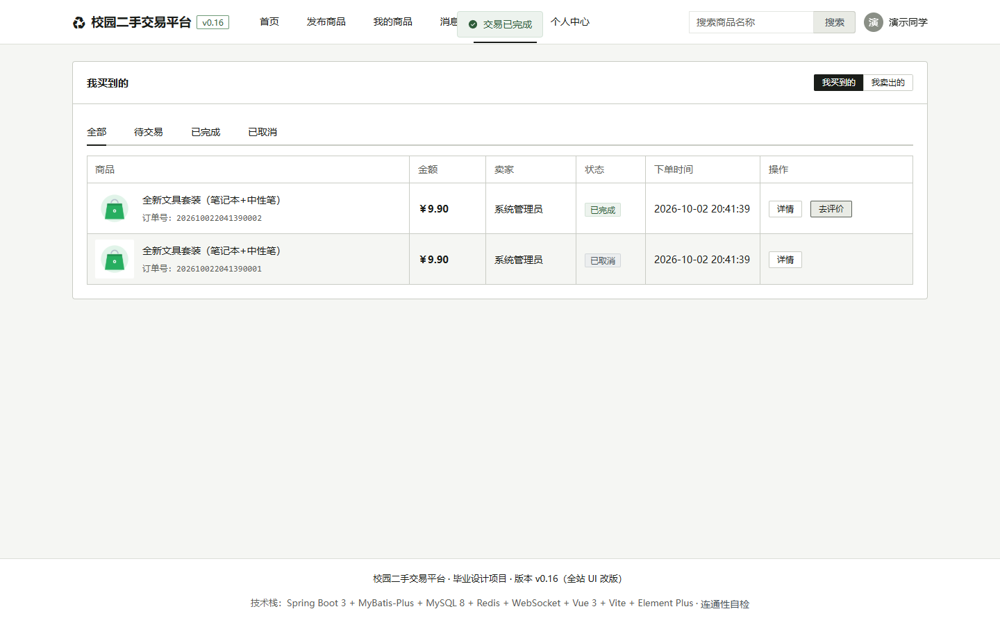

### 13-评价提交后

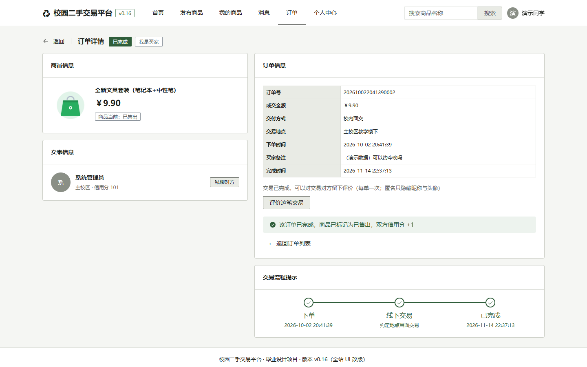

### 14-后台商品审核

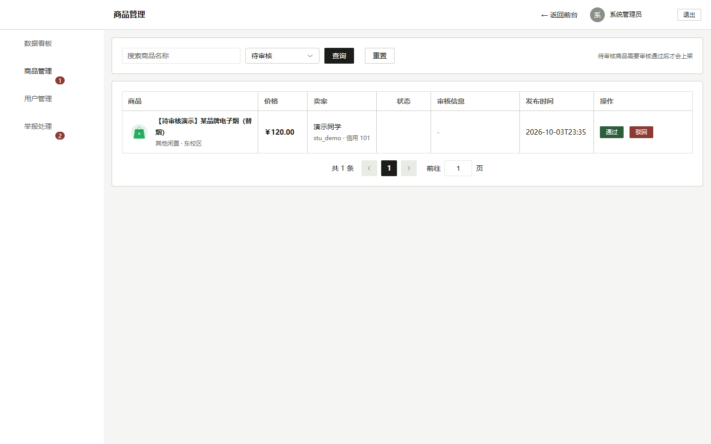

### 15-后台用户管理

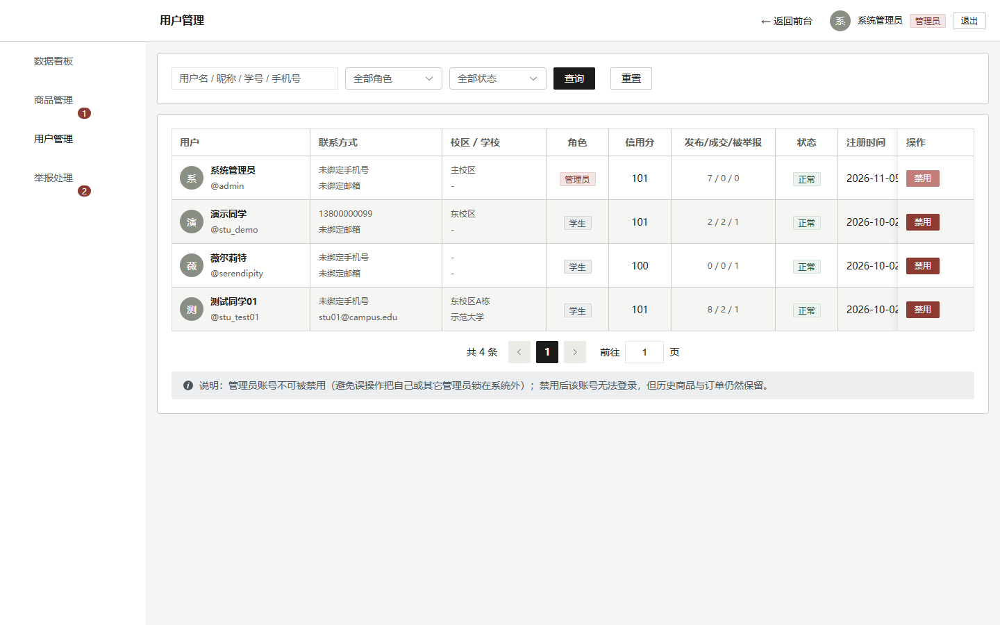

### 16-后台数据看板

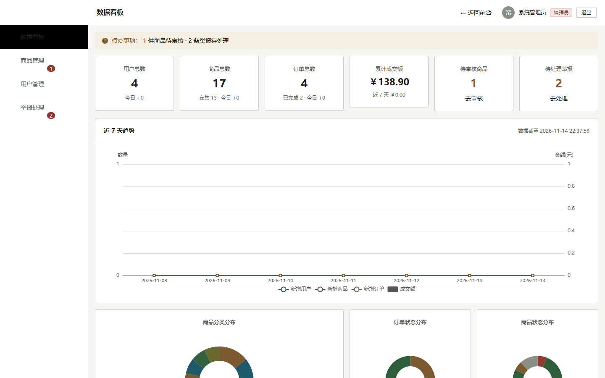

### 17-买家消息列表

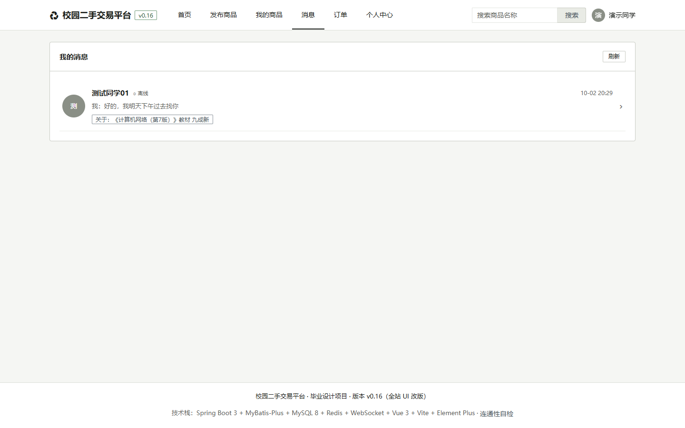
